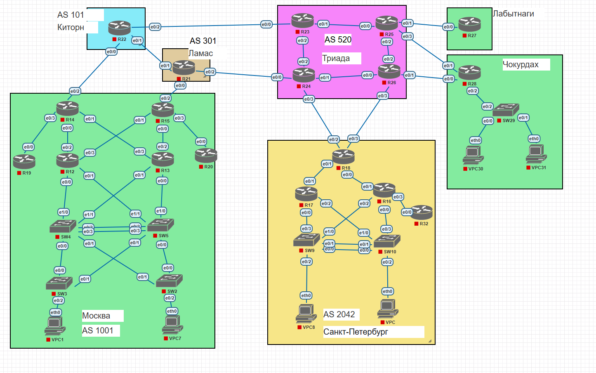
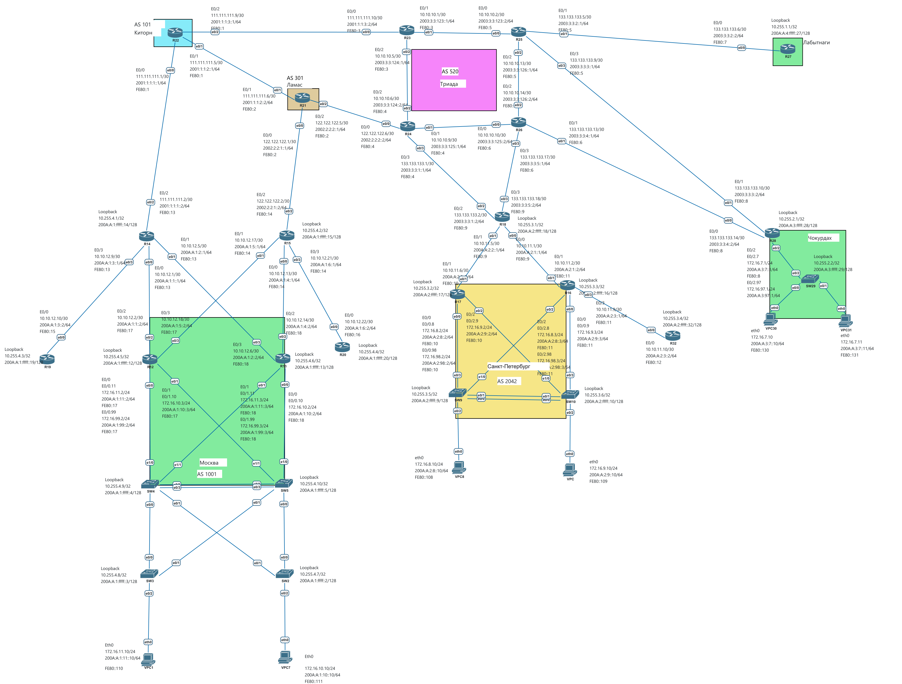

# IP адресация

## Топология

## Задачи
- Часть 1. Разработаете и задокументируете адресное пространство для лабораторного стенда.
- Часть 2. Настроите ip адреса на каждом активном порту
- Часть 3. Настроите каждый VPC в любом офисе в своем VLAN.
- Часть 4. Настроите VLAN управления для сетевых устройств
- Часть 5. Настроите сети офисов так, чтобы не возникало broadcast штормов, а использование линков было максимально оптимизировано
- Часть 6. Используете ipv4 и ipv6

## IPv4/IPv6 на всю сеть

#### Адресное пространство провайдеров IPV4

| Провайдер                      | IPv4-префикс     |
| ------------------------------ | ---------------- |
| Китрон                         | 111.111.111.0/28 |
| Ламас                          | 122.122.122.0/29 |
| Триада                         | 133.133.133.0/27 |
| Триада (внутренние соединения) | 10.10.10.0/28    |

#### Адресное пространство городов IPV4

| Город           | IPv4-префикс   |
| --------------- | -------------- |
| Москва          | 172.16.10.0/23 |
| Москва          | 10.10.12.0/27  |
| Москва          | 10.255.4.0/24  |
| Москва          | 172.16.99.0/24 |
| Санкт-Петербург | 172.16.8.0/23  |
| Санкт-Петербург | 10.10.11.0/28  |
| Санкт-Петербург | 10.255.3.0/24  |
| Санкт-Петербург | 172.16.98.0/24 |
| Чокурдах        | 172.16.7.0/24  |
| Чокурдах        | 10.255.2.0/24  |
| Чокурдах        | 172.16.97.0/24 |
| Лабытнаги      | 10.255.1.0/24  |
| Лабытнаги      | 172.16.27.0/24 |
| Лабытнаги      | 172.16.96.0/24 |

#### Адресное пространство провайдеров IPV6

| Провайдер | IPv6-префикс  |
| --------- | ------------- |
| Китрон    | 2001:1:1::/48 |
| Ламас     | 2002:2:2::/48 |
| Триада    | 2003:3:3::/48 |

#### Адресное пространство городов IPV6

| Город                  | IPv6-префикс     |
| ---------------------- | ---------------- |
| Общий блок организации | 200A:A::/32      |
| Москва                 | 200A:A:1::/48    |
| Москва                 | 200A:A:1:99::/64 |
| Санкт-Петербург        | 200A:A:2::/48    |
| Санкт-Петербург        | 200A:A:2:98::/64 |
| Чокурдах               | 200A:A:3::/48    |
| Чокурдах               | 200A:A:3:97::/64 |
| Лабытнаги             | 200A:A:4::/48    |
| Лабытнаги             | 200A:A:4:27::/64 |
| Лабытнаги             | 200A:A:4:96::/64 |

## Провайдеры:
- **Китрон**

| Провайдер | Устр. | Сеть             | Порт            | IPv4             | Примечание  |
| --------- | ----- | ---------------- | --------------- | ---------------- | ----------- |
| Китрон    | R22   | 111.111.111.0/30 | e0/0            | 111.111.111.1/30 | R14(Москва) |
|           |       | 2001:1:1:1::/64  | e0/0            | 2001:1:1:1::1/64 | R14(Москва) |
|           |       | FE80::/10        | Link-local e0/0 | FE80::1          |             |
|           |       | 111.111.111.4/30 | e0/1            | 111.111.111.5/30 | R21(Ламас)  |
|           |       | 2001:1:1:2::/64  | e0/1            | 2001:1:1:2::1/64 | R21(Ламас)  |
|           |       | FE80::/10        | Link-local e0/1 | FE80::1          |             |
|           |       | 111.111.111.8/30 | e0/2            | 111.111.111.9/30 | R23(Триада) |
|           |       | 2001:1:1:3::/64  | e0/2            | 2001:1:1:3::1/64 | R23(Триада) |
|           |       | FE80::/10        | Link-local e0/2 | FE80::1          |             |

- **Ламас**  

| Провайдер | Устр. | Сеть             | Порт            | IPv4             | Примечание  |
| --------- | ----- | ---------------- | --------------- | ---------------- | ----------- |
| Ламас     | R21   | 122.122.122.0/30 | e0/0            | 122.122.122.1/30 | R15(Москва) |
|           |       | 2002:2:2:1::/64  | e0/0            | 2002:2:2:1::1/64 | R15(Москва) |
|           |       | FE80::/10        | Link-local e0/0 | FE80::2          |             |
|           |       | 111.111.111.4/30 | e0/1            | 111.111.111.6/30 | R22(Китрон) |
|           |       | 2001:1:1:2::/64  | e0/1            | 2001:1:1:2::2/64 | R22(Китрон) |
|           |       | FE80::/10        | Link-local e0/1 | FE80::2          |             |
|           |       | 122.122.122.4/30 | e0/2            | 122.122.122.5/30 | R24(Триада) |
|           |       | 2002:2:2:2::/64  | e0/2            | 2002:2:2:2::1/64 | R24(Триада) |
|           |       | FE80::/10        | Link-local e0/2 | FE80::2          |             |

- **Триада**

| Провайдер | Устр. | Сеть              | Порт            | IPv4               | Примечание        |
| --------- | ----- | ----------------- | --------------- | ------------------ | ----------------- |
| Триада    | R23   | 111.111.111.8/30  | e0/0            | 111.111.111.10/30  | R22(Китрон)       |
|           |       | 2001:1:1:3::/64   | e0/0            | 2001:1:1:3::2/64   | R22(Китрон)       |
|           |       | FE80::/10         | Link-local e0/0 | FE80::3            |                   |
|           |       | 10.10.10.0/30     | e0/1            | 10.10.10.1/30      | R25(Триада)       |
|           |       | 2003:3:3:123::/64 | e0/1            | 2003:3:3:123::1/64 | R25(Триада)       |
|           |       | FE80::/10         | Link-local e0/1 | FE80::3            |                   |
|           |       | 10.10.10.4/30     | e0/2            | 10.10.10.5/30      | R24(Триада)       |
|           |       | 2003:3:3:124::/64 | e0/2            | 2003:3:3:124::1/64 | R24(Триада)       |
|           |       | FE80::/10         | Link-local e0/2 | FE80::3            |                   |
|           |       |                   |                 |                    |                   |
|           | R24   | 122.122.122.4/30  | e0/0            | 122.122.122.6/30   | R21(Ламас)        |
|           |       | 2002:2:2:2::/64   | e0/0            | 2002:2:2:2::2/64   | R21(Ламас)        |
|           |       | FE80::/10         | Link-local e0/0 | FE80::4            |                   |
|           |       | 10.10.10.8/30     | e0/1            | 10.10.10.9/30      | R26(Триада)       |
|           |       | 2003:3:3:125::/64 | e0/1            | 2003:3:3:125::1/64 | R26(Триада)       |
|           |       | FE80::/10         | Link-local e0/1 | FE80::4            |                   |
|           |       | 10.10.10.4/30     | e0/2            | 10.10.10.6/30      | R23(Триада)       |
|           |       | 2003:3:3:124::/64 | e0/2            | 2003:3:3:124::2/64 | R23(Триада)       |
|           |       | FE80::/10         | Link-local e0/2 | FE80::4            |                   |
|           |       | 133.133.133.0/30  | e0/3            | 133.133.133.1/30   | R18(С.-Петербург) |
|           |       | 2003:3:3:1::/64   | e0/3            | 2003:3:3:1::1/64   | R18(С.-Петербург) |
|           |       | FE80::/10         | Link-local e0/3 | FE80::4            |                   |
|           |       |                   |                 |                    |                   |
|           | R25   | 10.10.10.0/30     | e0/0            | 10.10.10.2/30      | R23(Триада)       |
|           |       | 2003:3:3:123::/64 | e0/0            | 2003:3:3:123::2/64 | R23(Триада)       |
|           |       | FE80::/10         | Link-local e0/0 | FE80::5            |                   |
|           |       | 133.133.133.4/30  | e0/1            | 133.133.133.5/30   | R27(Лабытнаги)    |
|           |       | 2003:3:3:2::/64   | e0/1            | 2003:3:3:2::1/64   | R27(Лабытнаги)    |
|           |       | FE80::/10         | Link-local e0/1 | FE80::5            |                   |
|           |       | 10.10.10.12/30    | e0/2            | 10.10.10.13/30     | R26(Триада)       |
|           |       | 2003:3:3:126::/64 | e0/2            | 2003:3:3:126::1/64 | R26(Триада)       |
|           |       | FE80::/10         | Link-local e0/2 | FE80::5            |                   |
|           |       | 133.133.133.8/30  | e0/3            | 133.133.133.9/30   | R28(Чокурдах)     |
|           |       | 2003:3:3:3::/64   | e0/3            | 2003:3:3:3::1/64   | R28(Чокурдах)     |
|           |       | FE80::/10         | Link-local e0/3 | FE80::5            |                   |
|           |       |                   |                 |                    |                   |
|           | R26   | 10.10.10.8/30     | e0/0            | 10.10.10.10/30     | R24(Триада)       |
|           |       | 2003:3:3:125::/64 | e0/0            | 2003:3:3:125::2/64 | R24(Триада)       |
|           |       | FE80::/10         | Link-local e0/0 | FE80::6            |                   |
|           |       | 133.133.133.12/30 | e0/1            | 133.133.133.13/30  | R28(Чокурдах)     |
|           |       | 2003:3:3:4::/64   | e0/1            | 2003:3:3:4::1/64   | R28(Чокурдах)     |
|           |       | FE80::/10         | Link-local e0/1 | FE80::6            |                   |
|           |       | 10.10.10.12/30    | e0/2            | 10.10.10.14/30     | R25(Триада)       |
|           |       | 2003:3:3:126::/64 | e0/2            | 2003:3:3:126::2/64 | R25(Триада)       |
|           |       | FE80::/10         | Link-local e0/2 | FE80::6            |                   |
|           |       | 133.133.133.16/30 | e0/3            | 133.133.133.17/30  | R18(С.-Петербург) |
|           |       | 2003:3:3:5::/64   | e0/3            | 2003:3:3:5::1/64   | R18(С.-Петербург) |
|           |       | FE80::/10         | Link-local e0/3 | FE80::6            |                   |

## Города:
- **Лабытнаги**

| Город     | Устр. | Сеть                  | Порт            | IPv4                  | Примечание  |
| --------- | ----- | --------------------- | --------------- | --------------------- | ----------- |
| Лабытнаги | R27   | 133.133.133.4/30      | e0/0            | 133.133.133.6/30      | R25(Триада) |
|           |       | 2003:3:3:2::/64       | e0/0            | 2003:3:3:2::2/64      |             |
|           |       | FE80::/10             | Link-local e0/0 | FE80::7               |             |
|           |       | 10.255.1.1/32         | Loopback        | 10.255.1.1/32         | IP-Loopback |
|           |       | 200A:A:4:ffff::27/128 | Loopback        | 200A:A:4:ffff::27/128 | IP-Loopback |

| Город     | Устройство | VLAN          | Gateway IPv4   | Gateway IPv6      |
| --------- | ---------- | ------------- | -------------- | ----------------- |
| Лабытнаги |            | 27/office27   | 172.16.27.1/24 | 200A:A:4:27::1/64 |
|           |            | 96/Management | 172.16.96.1/24 | 200A:A:4:96::1/64 |

- **Чокурдах**

| Город                 | Устр. | Сеть                  | Порт                | IPv4                  | Примечание     |
| --------------------- | ----- | --------------------- | ------------------- | --------------------- | -------------- |
| Чокурдах              | R28   | 133.133.133.12/30     | e0/0                | 133.133.133.14/30     | R26(Триада)    |
|                       |       | 2003:3:3:4::/64       | e0/0                | 2003:3:3:4::2/64      | R26(Триада)    |
|                       |       | FE80::/10             | Link-local  e0/0    | FE80::8               |                |
|                       |       | 133.133.133.8/30      | e0/1                | 133.133.133.10/30     | R25(Триада)    |
|                       |       | 2003:3:3:3::/64       | e0/1                | 2003:3:3:3::2/64      | R25(Триада)    |
|                       |       | FE80::/10             | Link-local  e0/1    | FE80::8               |                |
|                       |       |                       | e0/2                |                       | SW29(Чокурдах) |
|                       |       |                       | e0/2                |                       | SW29(Чокурдах) |
|                       |       |                       | Link-local  e0/2    |                       |                |
| **172.16.7.1**        |       | 172.16.7.0/24         | e0/2.7              | 172.16.7.1/24         | SW29(Чокурдах) |
| **200A:A:3:7::1/64**  |       | 200A:A:3:7::/64       | e0/2.7              | 200A:A:3:7::1/64      | SW29(Чокурдах) |
|                       |       | FE80::/10             | Link-local  e0/2.7  | FE80::8               |                |
| **172.16.97.1/24**    |       | 172.16.97.0/24        | e0/2.97             | 172.16.97.1/24        | SW29(Чокурдах) |
| **200A:A:3:97::1/64** |       | 200A:A:3:97::/64      | e0/2.97             | 200A:A:3:97::1/64     | SW29(Чокурдах) |
|                       |       | FE80::/10             | Link-local  e0/2.97 | FE80::8               |                |
|                       |       | 10.255.2.1/32         | Loopback            | 10.255.2.1/32         | IP-Loopback    |
|                       |       | 200A:A:3:ffff::28/128 | Loopback            | 200A:A:3:ffff::28/128 | IP-Loopback    |
|                       |       |                       |                     |                       |                |
|                       | SW29  | 10.255.2.2/32         | Loopback            | 10.255.2.2/32         | IP-Loopback    |
|                       |       | 200A:A:3:ffff::29/128 | Loopback            | 200A:A:3:ffff::29/128 | IP-Loopback    |
|                       |       | 172.16.97.0/24        | Vlan97              | 172.16.97.29/24       |                |
|                       |       | 200A:A:3:97::/64      | Vlan97              | 200A:A:3:97::29/64    |                |
| **Шлюз по умолчанию** |       | FE80::/10             | Vlan97 Link-local   | FE80::29              |                |
|                       |       |                       |                     |                       |                |
| **172.16.7.1**        | PC30  | 172.16.7.0/24         | Eth0                | 172.16.7.10/24        | SW29(Чокурдах) |
| **200A:A:3:7::1/64**  |       | 200A:A:3:7::/64       | Eth0                | 200A:A:3:7::10/64     | SW29(Чокурдах) |
|                       |       | FE80::/10             | Link-local Eth0     | FE80::130             |                |
| **172.16.7.1**        | PC31  | 172.16.7.0/24         | Eth0                | 172.16.7.11/24        | SW29(Чокурдах) |
| **200A:A:3:7::1/64**  |       | 200A:A:3:7::/64       | Eth0                | 200A:A:3:7::11/64     | SW29(Чокурдах) |
|                       |       | FE80::/10             | Link-local Eth0     | FE80::131             |                |

| Город    | Устройство | VLAN          | Gateway IPv4   | Gateway IPv6      |
| -------- | ---------- | ------------- | -------------- | ----------------- |
| Чокурдах | PC30, PC31 | 7/office7     | 172.16.7.1/24  | 200A:A:3:7::1/64  |
|          | SW29       | 97/Management | 172.16.97.1/24 | 200A:A:3:97::1/64 |

- **Санкт-Петербург**

| Город                 | Устр. | Сеть                  | Порт               | IPv4                  | Примечание          |
| --------------------- | ----- | --------------------- | ------------------ | --------------------- | ------------------- |
| С.-Петербург          | R18   | 10.10.11.0/30         | e0/0               | 10.10.11.1/30         | R16(С.-Петербург)   |
|                       |       | 200A:A:2:1::/64       | e0/0               | 200A:A:2:1::1/64      | R16(С.-Петербург)   |
|                       |       | FE80::/10             | Link-local e0/0    | FE80::9               |                     |
|                       |       | 10.10.11.4/30         | e0/1               | 10.10.11.5/30         | R17(С.-Петербург)   |
|                       |       | 200A:A:2:2::/64       | e0/1               | 200A:A:2:2::1/64      | R17(С.-Петербург)   |
|                       |       | FE80::/10             | Link-local e0/1    | FE80::9               |                     |
|                       |       | 133.133.133.0/30      | e0/2               | 133.133.133.2/30      | R24(Триада)         |
|                       |       | 2003:3:3:1::/64       | e0/2               | 2003:3:3:1::2/64      | R24(Триада)         |
|                       |       | FE80::/10             | Link-local e0/2    | FE80::9               |                     |
|                       |       | 133.133.133.16/30     | e0/3               | 133.133.133.18/30     | R26(Триада)         |
|                       |       | 2003:3:3:5::/64       | e0/3               | 2003:3:3:5::2/64      | R26(Триада)         |
|                       |       | FE80::/10             | Link-local e0/3    | FE80::9               |                     |
|                       |       | 10.255.3.1/32         | Loopback           | 10.255.3.1/32         | IP-Loopback         |
|                       |       | 200A:A:2:ffff::18/128 | Loopback           | 200A:A:2:ffff::18/128 | IP-Loopback         |
|                       |       |                       |                    |                       |                     |
|                       | R17   |                       | e0/0               |                       | SW9 (С.-Петербург)  |
|                       |       |                       | e0/0               |                       | SW9 (С.-Петербург)  |
| **Шлюз по умолчанию** |       |                       | Link-local e0/0    |                       |                     |
| **172.16.8.1**        |       | 172.16.8.0/24         | e0/0.8             | 172.16.8.2/24         | SW9 (С.-Петербург)  |
| **200A:A:2:8::1/64**  |       | 200A:A:2:8::/64       | e0/0.8             | 200A:A:2:8::2/64      | SW9 (С.-Петербург)  |
|                       |       | FE80::/10             | Link-local e0/0.8  | FE80::10              |                     |
| **172.16.98.1/24**    |       | 172.16.98.0/24        | e0/0.98            | 172.16.98.2/24        | SW9 (С.-Петербург)  |
| **200A:A:2:98::1/64** |       | 200A:A:2:98::/64      | e0/0.98            | 200A:A:2:98::2/64     | SW9 (С.-Петербург)  |
|                       |       | FE80::/10             | Link-local e0/0.98 | FE80::10              |                     |
|                       |       | 10.10.11.4/30         | e0/1               | 10.10.11.6/30         | R18(С.-Петербург)   |
|                       |       | 200A:A:2:2::/64       | e0/1               | 200A:A:2:2::2/64      | R18(С.-Петербург)   |
|                       |       | FE80::/10             | Link-local e0/1    | FE80::10              |                     |
|                       |       |                       | e0/2               |                       | SW10 (С.-Петербург) |
|                       |       |                       | e0/2               |                       | SW10 (С.-Петербург) |
| **Шлюз по умолчанию** |       |                       | Link-local e0/2    |                       |                     |
| **172.16.9.1**        |       | 172.16.9.0/24         | e0/2.9             | 172.16.9.2/24         | SW10 (С.-Петербург) |
| **200A:A:2:9::1/64**  |       | 200A:A:2:9::/64       | e0/2.9             | 200A:A:2:9::2/64      | SW10 (С.-Петербург) |
|                       |       | FE80::/10             | Link-local e0/2.9  | FE80::10              |                     |
|                       |       | 10.255.3.2/32         | Loopback           | 10.255.3.2/32         | IP-Loopback         |
|                       |       | 200A:A:2:ffff::17/128 | Loopback           | 200A:A:2:ffff::17/128 | IP-Loopback         |
|                       |       |                       |                    |                       |                     |
|                       | R16   |                       | e0/0               |                       | SW10 (С.-Петербург) |
|                       |       |                       | e0/0               |                       | SW10 (С.-Петербург) |
| **Шлюз по умолчанию** |       |                       | Link-local e0/0    |                       |                     |
| **172.16.9.1**        |       | 172.16.9.0/24         | e0/0.9             | 172.16.9.3/24         | SW10 (С.-Петербург) |
| **200A:A:2:9::1/64**  |       | 200A:A:2:9::/64       | e0/0.9             | 200A:A:2:9::3/64      | SW10 (С.-Петербург) |
|                       |       | FE80::/10             | Link-local e0/0.9  | FE80::11              |                     |
|                       |       | 10.10.11.0/30         | e0/1               | 10.10.11.2/30         | R18(С.-Петербург)   |
|                       |       | 200A:A:2:1::/64       | e0/1               | 200A:A:2:1::2/64      | R18(С.-Петербург)   |
|                       |       | FE80::/10             | Link-local e0/1    | FE80::11              |                     |
|                       |       |                       | e0/2               |                       | SW9 (С.-Петербург)  |
|                       |       |                       | e0/2               |                       | SW9 (С.-Петербург)  |
| **Шлюз по умолчанию** |       |                       | Link-local e0/2    |                       |                     |
| **172.16.8.1**        |       | 172.16.8.0/24         | e0/2.8             | 172.16.8.3/24         | SW9 (С.-Петербург)  |
| **200A:A:2:8::1/64**  |       | 200A:A:2:8::/64       | e0/2.8             | 200A:A:2:8::3/64      | SW9 (С.-Петербург)  |
|                       |       | FE80::/10             | Link-local e0/2.8  | FE80::11              |                     |
| **172.16.98.1/24**    |       | 172.16.98.0/24        | e0/2.98            | 172.16.98.3/24        | SW9 (С.-Петербург)  |
| **200A:A:2:98::1/64** |       | 200A:A:2:98::/64      | e0/2.98            | 200A:A:2:98::3/64     | SW9 (С.-Петербург)  |
|                       |       | FE80::/10             | Link-local e0/2.98 | FE80::11              |                     |
|                       |       | 10.10.11.8/30         | e0/3               | 10.10.11.9/30         | R32(С.-Петербург)   |
|                       |       | 200A:A:2:3::/64       | e0/3               | 200A:A:2:3::1/64      | R32(С.-Петербург)   |
|                       |       | FE80::/10             | Link-local e0/3    | FE80::11              |                     |
|                       |       | 10.255.3.3/32         | Loopback           | 10.255.3.3/32         | IP-Loopback         |
|                       |       | 200A:A:2:ffff::16/128 | Loopback           | 200A:A:2:ffff::16/128 | IP-Loopback         |
|                       |       |                       |                    |                       |                     |
|                       | R32   | 10.10.11.8/30         | e0/0               | 10.10.11.10/30        | R16(С.-Петербург)   |
|                       |       | 200A:A:2:3::/64       | e0/0               | 200A:A:2:3::2/64      | R16(С.-Петербург)   |
|                       |       | FE80::/10             | Link-local e0/0    | FE80::12              |                     |
|                       |       | 10.255.3.4/32         | Loopback           | 10.255.3.4/32         | IP-Loopback         |
|                       |       | 200A:A:2:ffff::32/128 | Loopback           | 200A:A:2:ffff::32/128 | IP-Loopback         |
|                       |       |                       |                    |                       |                     |
|                       | SW9   | 10.255.3.5/32         | Loopback           | 10.255.3.5/32         | IP-Loopback         |
|                       |       | 200A:A:2:ffff::9/128  | Loopback           | 200A:A:2:ffff::9/128  | IP-Loopback         |
| **172.16.98.1/24**    |       | 172.16.98.0/24        | Vlan98             | 172.16.98.9/24        |                     |
| **200A:A:2:98::1/64** |       | 200A:A:2:98::/64      | Vlan98             | 200A:A:2:98::9/64     |                     |
|                       |       | FE80::/10             | Vlan98 Link-local  | FE80::23              |                     |
|                       |       |                       |                    |                       |                     |
|                       | SW10  | 10.255.3.6/32         | Loopback           | 10.255.3.6/32         | IP-Loopback         |
|                       |       | 200A:A:2:ffff::10/128 | Loopback           | 200A:A:2:ffff::10/128 | IP-Loopback         |
| **172.16.98.1/24**    |       | 172.16.98.0/24        | Vlan98             | 172.16.98.10/24       |                     |
| **200A:A:2:98::1/64** |       | 200A:A:2:98::/64      | Vlan98             | 200A:A:2:98::10/64    |                     |
|                       |       | FE80::/10             | Vlan98 Link-local  | FE80::23              |                     |
| **Шлюз по умолчанию** |       |                       |                    |                       |                     |
| **172.16.8.1**        | PC8   | 172.16.8.0/24         | Eth0               | 172.16.8.10/24        | SW9(С.-Петербург)   |
| **200A:A:2:8::1/64**  |       | 200A:A:2:8::/64       | Eth0               | 200A:A:2:8::10/64     | SW9(С.-Петербург)   |
|                       |       | FE80::/10             | Link-local Eth0    | FE80::108             |                     |
| **172.16.9.1**        | PC    | 172.16.9.0/24         | Eth0               | 172.16.9.10/24        | SW10(С.-Петербург)  |
| **200A:A:2:9::1/64**  |       | 200A:A:2:9::/64       | Eth0               | 200A:A:2:9::10/64     | SW10(С.-Петербург)  |
|                       |       | FE80::/10             | Link-local Eth0    | FE80::109             |                     |

| Город        | Устройство | VLAN          | Gateway IPv4   | Gateway IPv6      |
| ------------ | ---------- | ------------- | -------------- | ----------------- |
| С.-Петербург | PC8        | 8/office8     | 172.16.8.1/24  | 200A:A:2:8::1/64  |
|              | PC         | 9/office9     | 172.16.9.1/24  | 200A:A:2:9::1/64  |
|              | SW9, SW10  | 98/Management | 172.16.98.1/24 | 200A:A:2:98::1/64 |

- **Москва**

| Город                 | Устр. | Сеть                  | Порт               | IPv4                  | Примечание  |
| --------------------- | ----- | --------------------- | ------------------ | --------------------- | ----------- |
| Москва                | R14   | 10.10.12.0/30         | e0/0               | 10.10.12.1/30         | R12(Москва) |
|                       |       | 200A:A:1:1::/64       | e0/0               | 200A:A:1:1::1/64      | R12(Москва) |
|                       |       | FE80::/10             | Link-local e0/0    | FE80::13              |             |
|                       |       | 10.10.12.4/30         | e0/1               | 10.10.12.5/30         | R13(Москва) |
|                       |       | 200A:A:1:2::/64       | e0/1               | 200A:A:1:2::1/64      | R13(Москва) |
|                       |       | FE80::/10             | Link-local e0/1    | FE80::13              |             |
|                       |       | 111.111.111.0/30      | e0/2               | 111.111.111.2/30      | R22(Китрон) |
|                       |       | 2001:1:1:1::/64       | e0/2               | 2001:1:1:1::2/64      | R22(Китрон) |
|                       |       | FE80::/10             | Link-local e0/2    | FE80::13              |             |
|                       |       | 10.10.12.8/30         | e0/3               | 10.10.12.9/30         | R19(Москва) |
|                       |       | 200A:A:1:3::/64       | e0/3               | 200A:A:1:3::1/64      | R19(Москва) |
|                       |       | FE80::/10             | Link-local e0/3    | FE80::13              |             |
|                       |       | 10.255.4.1/32         | Loopback           | 10.255.4.1/32         | IP-Loopback |
|                       |       | 200A:A:1:ffff::14/128 | Loopback           | 200A:A:1:ffff::14/128 | IP-Loopback |
|                       |       |                       |                    |                       |             |
|                       | R15   | 10.10.12.12/30        | e0/0               | 10.10.12.13/30        | R13(Москва) |
|                       |       | 200A:A:1:4::/64       | e0/0               | 200A:A:1:4::1/64      | R13(Москва) |
|                       |       | FE80::/10             | Link-local e0/0    | FE80::14              |             |
|                       |       | 10.10.12.16/30        | e0/1               | 10.10.12.17/30        | R12(Москва) |
|                       |       | 200A:A:1:5::/64       | e0/1               | 200A:A:1:5::1/64      | R12(Москва) |
|                       |       | FE80::/10             | Link-local e0/1    | FE80::14              |             |
|                       |       | 122.122.122.0/30      | e0/2               | 122.122.122.2/30      | R21(Ламас)  |
|                       |       | 2002:2:2:1::/64       | e0/2               | 2002:2:2:1::2/64      | R21(Ламас)  |
|                       |       | FE80::/10             | Link-local e0/2    | FE80::14              |             |
|                       |       | 10.10.12.20/30        | e0/3               | 10.10.12.21/30        | R20(Москва) |
|                       |       | 200A:A:1:6::/64       | e0/3               | 200A:A:1:6::1/64      | R20(Москва) |
|                       |       | FE80::/10             | Link-local e0/3    | FE80::14              |             |
|                       |       | 10.255.4.2/32         | Loopback           | 10.255.4.2/32         | IP-Loopback |
|                       |       | 200A:A:1:ffff::15/128 | Loopback           | 200A:A:1:ffff::15/128 | IP-Loopback |
|                       |       |                       |                    |                       |             |
|                       | R19   | 10.10.12.8/30         | e0/0               | 10.10.12.10/30        | R14(Москва) |
|                       |       | 200A:A:1:3::/64       | e0/0               | 200A:A:1:3::2/64      | R14(Москва) |
|                       |       | FE80::/10             | Link-local e0/0    | FE80::15              |             |
|                       |       | 10.255.4.3/32         | Loopback           | 10.255.4.3/32         | IP-Loopback |
|                       |       | 200A:A:1:ffff::19/128 | Loopback           | 200A:A:1:ffff::19/128 | IP-Loopback |
|                       |       |                       |                    |                       |             |
|                       | R20   | 10.10.12.20/30        | e0/0               | 10.10.12.22/30        | R15(Москва) |
|                       |       | 200A:A:1:6::/64       | e0/0               | 200A:A:1:6::2/64      | R15(Москва) |
|                       |       | FE80::/10             | Link-local e0/0    | FE80::16              |             |
|                       |       | 10.255.4.4/32         | Loopback           | 10.255.4.4/32         | IP-Loopback |
|                       |       | 200A:A:1:ffff::20/128 | Loopback           | 200A:A:1:ffff::20/128 | IP-Loopback |
|                       |       |                       |                    |                       |             |
|                       | R12   |                       | e0/0               |                       | SW4(Москва) |
|                       |       |                       | e0/0               |                       | SW4(Москва) |
| **Шлюз по умолчанию** |       |                       | Link-local e0/0    |                       |             |
| **172.16.11.1**       |       | 172.16.11.0/24        | e0/0.11            | 172.16.11.2/24        | SW4(Москва) |
| **200A:A:1:11::1/64** |       | 200A:A:1:11::/64      | e0/0.11            | 200A:A:1:11::2/64     | SW4(Москва) |
|                       |       | FE80::/10             | Link-local e0/0.11 | FE80::17              |             |
| **172.16.99.1/24**    |       | 172.16.99.0/24        | e0/0.99            | 172.16.99.2/24        |             |
| **200A:A:1:99::1/64** |       | 200A:A:1:99::/64      | e0/0.99            | 200A:A:1:99::2/64     |             |
|                       |       | FE80::/10             | Link-local e0/0.99 | FE80::17              |             |
|                       |       |                       | e0/1               |                       | SW5(Москва) |
|                       |       |                       | e0/1               |                       | SW5(Москва) |
|                       |       |                       | Link-local e0/1    |                       |             |
| **172.16.10.1**       |       | 172.16.10.0/24        | e0/1.10            | 172.16.10.3/24        | SW5(Москва) |
| **200A:A:1:10::1/64** |       | 200A:A:1:10::/64      | e0/1.10            | 200A:A:1:10::3/64     | SW5(Москва) |
|                       |       | FE80::/10             | Link-local e0/1.10 | FE80::17              |             |
|                       |       | 10.10.12.0/30         | e0/2               | 10.10.12.2/30         | R14(Москва) |
|                       |       | 200A:A:1:1::/64       | e0/2               | 200A:A:1:1::2/64      | R14(Москва) |
|                       |       | FE80::/10             | Link-local e0/2    | FE80::17              |             |
|                       |       | 10.10.12.16/30        | e0/3               | 10.10.12.18/30        | R15(Москва) |
|                       |       | 200A:A:1:5::/64       | e0/3               | 200A:A:1:5::2/64      | R15(Москва) |
|                       |       | FE80::/10             | Link-local e0/3    | FE80::17              |             |
|                       |       | 10.255.4.5/32         | Loopback           | 10.255.4.5/32         | IP-Loopback |
|                       |       | 200A:A:1:ffff::12/128 | Loopback           | 200A:A:1:ffff::12/128 | IP-Loopback |
|                       |       |                       |                    |                       |             |
|                       | R13   |                       | e0/0               |                       | SW5(Москва) |
|                       |       |                       | e0/0               |                       | SW5(Москва) |
| **Шлюз по умолчанию** |       |                       | Link-local e0/0    |                       |             |
| **172.16.10.1**       |       | 172.16.10.0/24        | e0/0.10            | 172.16.10.2/24        | SW5(Москва) |
| **200A:A:1:10::1/64** |       | 200A:A:1:10::/64      | e0/0.10            | 200A:A:1:10::2/64     | SW5(Москва) |
|                       |       | FE80::/10             | e0/0.10 Link-local | FE80::18              |             |
|                       |       |                       | e0/1               |                       | SW4(Москва) |
|                       |       |                       | e0/1               |                       | SW4(Москва) |
|                       |       |                       | Link-local e0/1    |                       |             |
| **172.16.11.1**       |       | 172.16.11.0/24        | e0/1.11            | 172.16.11.3/24        | SW4(Москва) |
| **200A:A:1:11::1/64** |       | 200A:A:1:11::/64      | e0/1.11            | 200A:A:1:11::3/64     | SW4(Москва) |
|                       |       | FE80::/10             | Link-local e0/1.11 | FE80::18              |             |
| **172.16.99.1/24**    |       | 172.16.99.0/24        | e0/1.99            | 172.16.99.3/24        | SW4(Москва) |
| **200A:A:1:99::1/64** |       | 200A:A:1:99::/64      | e0/1.99            | 200A:A:1:99::3/64     | SW4(Москва) |
|                       |       | FE80::/10             | e0/1.99 Link-local | FE80::18              |             |
|                       |       | 10.10.12.12/30        | e0/2               | 10.10.12.14/30        | R15(Москва) |
|                       |       | 200A:A:1:4::/64       | e0/2               | 200A:A:1:4::2/64      | R15(Москва) |
|                       |       | FE80::/10             | Link-local e0/2    | FE80::18              |             |
|                       |       | 10.10.12.4/30         | e0/3               | 10.10.12.6/30         | R14(Москва) |
|                       |       | 200A:A:1:2::/64       | e0/3               | 200A:A:1:2::2/64      | R14(Москва) |
|                       |       | FE80::/10             | Link-local e0/3    | FE80::18              |             |
|                       |       | 10.255.4.6/32         | Loopback           | 10.255.4.6/32         | IP-Loopback |
|                       |       | 200A:A:1:ffff::13/128 | Loopback           | 200A:A:1:ffff::13/128 | IP-Loopback |
|                       |       |                       |                    |                       |             |
|                       | SW2   | 10.255.4.7/32         | Loopback           | 10.255.4.7/32         | IP-Loopback |
|                       |       | 200A:A:1:ffff::2/128  | Loopback           | 200A:A:1:ffff::2/128  | IP-Loopback |
| **172.16.99.1/24**    |       | 172.16.99.0/24        | Vlan99             | 172.16.99.7/24        |             |
| **200A:A:1:99::1/64** |       | 200A:A:1:99::/64      | Vlan99             | 200A:A:1:99::7/64     |             |
|                       |       | FE80::/10             | Vlan99 Link-local  | FE80::19              |             |
|                       |       |                       |                    |                       |             |
|                       | SW3   | 10.255.4.8/32         | Loopback           | 10.255.4.8/32         | IP-Loopback |
|                       |       | 200A:A:1:ffff::3/128  | Loopback           | 200A:A:1:ffff::3/128  | IP-Loopback |
| **172.16.99.1/24**    |       | 172.16.99.0/24        | Vlan99             | 172.16.99.8/24        |             |
| **200A:A:1:99::1/64** |       | 200A:A:1:99::/64      | Vlan99             | 200A:A:1:99::8/64     |             |
|                       |       | FE80::/10             | Vlan99 Link-local  | FE80::20              |             |
|                       |       |                       |                    |                       |             |
|                       | SW4   | 10.255.4.9/32         | Loopback           | 10.255.4.9/32         | IP-Loopback |
|                       |       | 200A:A:1:ffff::4/128  | Loopback           | 200A:A:1:ffff::4/128  | IP-Loopback |
| **172.16.99.1/24**    |       | 172.16.99.0/24        | Vlan99             | 172.16.99.9/24        |             |
| **200A:A:1:99::1/64** |       | 200A:A:1:99::/64      | Vlan99             | 200A:A:1:99::9/64     |             |
|                       |       | FE80::/10             | Vlan99 Link-local  | FE80::21              |             |
|                       |       |                       |                    |                       |             |
|                       | SW5   | 10.255.4.10/32        | Loopback           | 10.255.4.10/32        | IP-Loopback |
|                       |       | 200A:A:1:ffff::5/128  | Loopback           | 200A:A:1:ffff::5/128  | IP-Loopback |
| **172.16.99.1/24**    |       | 172.16.99.0/24        | Vlan99             | 172.16.99.10/24       |             |
| **200A:A:1:99::1/64** |       | 200A:A:1:99::/64      | Vlan99             | 200A:A:1:99::10/64    |             |
|                       |       | FE80::/10             | Vlan99 Link-local  | FE80::22              |             |
| **Шлюз по умолчанию** |       |                       |                    |                       |             |
| **172.16.10.1**       | VPC7  | 172.16.10.0/24        | Eth0               | 172.16.10.10/24       | SW2(Москва) |
| **200A:A:1:10::1/64** |       | 200A:A:1:10::/64      | Eth0               | 200A:A:1:10::10/64    | SW2(Москва) |
|                       |       | FE80::/10             | Link-local Eth0    | FE80::111             |             |
| **172.16.11.1**       | VPC1  | 172.16.11.0/24        | Eth0               | 172.16.11.10/24       | SW3(Москва) |
| **200A:A:1:11::1/64** |       | 200A:A:1:11::/64      | Eth0               | 200A:A:1:11::10/64    | SW3(Москва) |
|                       |       | FE80::/10             | Link-local Eth0    | FE80::110             |             |

| Город  | Устройство         | VLAN          | Gateway IPv4   | Gateway IPv6      |
| ------ | ------------------ | ------------- | -------------- | ----------------- |
| Москва | PC1                | 11/office11   | 172.16.11.1/24 | 200A:A:1:11::1/64 |
|        | PC7                | 10/office10   | 172.16.10.1/24 | 200A:A:1:10::1/64 |
|        | SW2, SW3, SW4, SW5 | 99/Management | 172.16.99.1/24 | 200A:A:1:99::1/64 |

## Список используемых сетей

| Имя             | Сеть                  |
| --------------- | --------------------- |
| Китрон          | 111.111.111.0/30      |
|                 | 111.111.111.4/30      |
|                 | 111.111.111.8/30      |
|                 | 2001:1:1:1::/64       |
|                 | 2001:1:1:2::/64       |
|                 | 2001:1:1:3::/64       |
|                 | FE80::/10             |
| Ламас           | 122.122.122.0/30      |
|                 | 122.122.122.4/30      |
|                 | 2002:2:2:1::/64       |
|                 | 2002:2:2:2::/64       |
|                 | FE80::/10             |
| Триада          | 10.10.10.0/30         |
|                 | 10.10.10.4/30         |
|                 | 10.10.10.8/30         |
|                 | 10.10.10.12/30        |
|                 | 133.133.133.0/30      |
|                 | 133.133.133.4/30      |
|                 | 133.133.133.8/30      |
|                 | 133.133.133.12/30     |
|                 | 133.133.133.16/30     |
|                 | 2003:3:3:1::/64       |
|                 | 2003:3:3:2::/64       |
|                 | 2003:3:3:3::/64       |
|                 | 2003:3:3:4::/64       |
|                 | 2003:3:3:5::/64       |
|                 | 2003:3:3:123::/64     |
|                 | 2003:3:3:124::/64     |
|                 | 2003:3:3:125::/64     |
|                 | 2003:3:3:126::/64     |
|                 | FE80::/10             |
| Лабытнаги       | 10.255.1.1/32         |
|                 | 172.16.27.0/24        |
|                 | 172.16.96.0/24        |
|                 | 200A:A:4:ffff::27/128 |
|                 | 200A:A:4:27::/64      |
|                 | 200A:A:4:96::/64      |
|                 | FE80::/10             |
| Чокурдах        | 172.16.7.0/24         |
|                 | 10.255.2.1/32         |
|                 | 10.255.2.2/32         |
|                 | 172.16.97.0/24        |
|                 | 200A:A:3:7::/64       |
|                 | 200A:A:3:97::/64      |
|                 | 200A:A:3:ffff::28/128 |
|                 | 200A:A:3:ffff::29/128 |
|                 | FE80::/10             |
| Санкт-Петербург | 10.10.11.0/30         |
|                 | 10.10.11.4/30         |
|                 | 10.10.11.8/30         |
|                 | 10.255.3.1/32         |
|                 | 10.255.3.2/32         |
|                 | 10.255.3.3/32         |
|                 | 10.255.3.4/32         |
|                 | 10.255.3.5/32         |
|                 | 10.255.3.6/32         |
|                 | 172.16.8.0/24         |
|                 | 172.16.9.0/24         |
|                 | 172.16.98.0/24        |
|                 | 200A:A:2:1::/64       |
|                 | 200A:A:2:2::/64       |
|                 | 200A:A:2:3::/64       |
|                 | 200A:A:2:8::/64       |
|                 | 200A:A:2:9::/64       |
|                 | 200A:A:2:98::/64      |
|                 | 200A:A:2:ffff::9/128  |
|                 | 200A:A:2:ffff::10/128 |
|                 | 200A:A:2:ffff::16/128 |
|                 | 200A:A:2:ffff::17/128 |
|                 | 200A:A:2:ffff::18/128 |
|                 | 200A:A:2:ffff::32/128 |
|                 | FE80::/10             |
| Москва          | 10.10.12.0/30         |
|                 | 10.10.12.4/30         |
|                 | 10.10.12.8/30         |
|                 | 10.10.12.12/30        |
|                 | 10.10.12.16/30        |
|                 | 10.10.12.20/30        |
|                 | 10.255.4.1/32         |
|                 | 10.255.4.2/32         |
|                 | 10.255.4.3/32         |
|                 | 10.255.4.4/32         |
|                 | 10.255.4.5/32         |
|                 | 10.255.4.6/32         |
|                 | 10.255.4.7/32         |
|                 | 10.255.4.8/32         |
|                 | 10.255.4.9/32         |
|                 | 10.255.4.10/32        |
|                 | 172.16.10.0/24        |
|                 | 172.16.11.0/24        |
|                 | 172.16.99.0/24        |
|                 | 200A:A:1:1::/64       |
|                 | 200A:A:1:2::/64       |
|                 | 200A:A:1:3::/64       |
|                 | 200A:A:1:4::/64       |
|                 | 200A:A:1:5::/64       |
|                 | 200A:A:1:6::/64       |
|                 | 200A:A:1:10::/64      |
|                 | 200A:A:1:11::/64      |
|                 | 200A:A:1:99::/64      |
|                 | 200A:A:1:ffff::2/128  |
|                 | 200A:A:1:ffff::3/128  |
|                 | 200A:A:1:ffff::4/128  |
|                 | 200A:A:1:ffff::5/128  |
|                 | 200A:A:1:ffff::12/128 |
|                 | 200A:A:1:ffff::13/128 |
|                 | 200A:A:1:ffff::14/128 |
|                 | 200A:A:1:ffff::15/128 |
|                 | 200A:A:1:ffff::19/128 |
|                 | 200A:A:1:ffff::20/128 |
|                 | FE80::/10             |

## Обоснование выбора IPv4/IPv6-адресации
Я решил использовать иерархическую адресацию:
1. Каждому провайдеру выделено собственное адресное пространство.
2. Организация имеет независимый IPv6-агрегат (крупный блок IP-адресов в протоколе IPv6), который не зависит от адресного пространства провайдеров.
3. Каждому городу выделяется собственный IPv6-префикс.
4. Внутри каждого города выделяются отдельные подсети для межмаршрутизаторных соединений, пользовательских VLAN, управления и Loopback.
5. Для межмаршрутизаторных IPv4-соединений используются небольшие point-to-point подсети.
Такой подход позволяет не смешивать провайдерскую и корпоративную адресацию.

**Конфигурации:**
- [R12](Configurations/R12.txt)
- [R13](Configurations/R13.txt)
- [R14](Configurations/R14.txt)
- [R15](Configurations/R15.txt)
- [R16](Configurations/R16.txt)
- [R17](Configurations/R17.txt)
- [R18](Configurations/R18.txt)
- [R19](Configurations/R19.txt)
- [R20](Configurations/R20.txt)
- [R21](Configurations/R21.txt)
- [R22](Configurations/R22.txt)
- [R23](Configurations/R23.txt)
- [R24](Configurations/R24.txt)
- [R25](Configurations/R25.txt)
- [R26](Configurations/R26.txt)
- [R27](Configurations/R27.txt)
- [R28](Configurations/R28.txt)
- [R32](Configurations/R32.txt)
- [SW2](Configurations/SW2.txt)
- [SW3](Configurations/SW3.txt)
- [SW4](Configurations/SW4.txt)
- [SW5](Configurations/SW5.txt)
- [SW9](Configurations/SW9.txt)
- [SW10](Configurations/SW10.txt)
- [SW29](Configurations/SW29.txt)
- [VPC](Configurations/VPC.txt)
- [VPC1](Configurations/VPC1.txt)
- [VPC7](Configurations/VPC7.txt)
- [VPC8](Configurations/VPC8.txt)
- [VPC30](Configurations/VPC30.txt)
- [VPC31](Configurations/VPC31.txt)