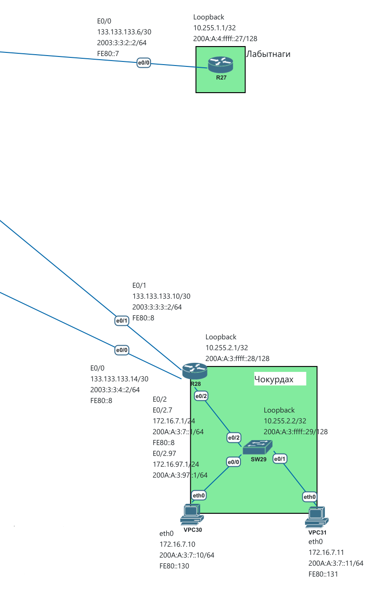

# IP SLA

## Топология



## Цель
Настроить политику маршрутизации в офисе Чокурдах.
Распределить трафик между 2 линками.

## Задачи
- Часть 1. Настроите политику маршрутизации для сетей офиса Чокурдах
- Часть 2. Распределите трафик между двумя линками с провайдером в Чокурдах
- Часть 3. Настроите отслеживание линка через технологию IP SLA в Чокурдах
- Часть 4. Настройте для офиса Лабытнанги маршрут по умолчанию
- Часть 3. План работы и изменения зафиксированы в документации

---

- R25
```
ip route 172.16.7.0 255.255.255.0 133.133.133.10
ip route 172.16.97.0 255.255.255.0 133.133.133.10

ipv6 route 200A:A:3:7::/64 2003:3:3:3::2
ipv6 route 200A:A:3:97::/64 2003:3:3:3::2
```

- R26
```
ip route 172.16.7.0 255.255.255.0 133.133.133.14
ip route 172.16.97.0 255.255.255.0 133.133.133.14

ipv6 route 200A:A:3:7::/64 2003:3:3:4::2
ipv6 route 200A:A:3:97::/64 2003:3:3:4::2
```

*OSPF на "Триада" не настроен.

---

## Настроить политику маршрутизации для сетей офиса Чокурдах

- **Чокурдах**

| Город                 | Устр. | Сеть                  | Порт                | IPv4                  | Примечание     |
| --------------------- | ----- | --------------------- | ------------------- | --------------------- | -------------- |
| Чокурдах              | R28   | 133.133.133.12/30     | e0/0                | 133.133.133.14/30     | R26(Триада)    |
|                       |       | 2003:3:3:4::/64       | e0/0                | 2003:3:3:4::2/64      | R26(Триада)    |
|                       |       | FE80::/10             | Link-local  e0/0    | FE80::8               |                |
|                       |       | 133.133.133.8/30      | e0/1                | 133.133.133.10/30     | R25(Триада)    |
|                       |       | 2003:3:3:3::/64       | e0/1                | 2003:3:3:3::2/64      | R25(Триада)    |
|                       |       | FE80::/10             | Link-local  e0/1    | FE80::8               |                |
|                       |       |                       | e0/2                |                       | SW29(Чокурдах) |
|                       |       |                       | e0/2                |                       | SW29(Чокурдах) |
|                       |       |                       | Link-local  e0/2    |                       |                |
| **172.16.7.1**        |       | 172.16.7.0/24         | e0/2.7              | 172.16.7.1/24         | SW29(Чокурдах) |
| **200A:A:3:7::1/64**  |       | 200A:A:3:7::/64       | e0/2.7              | 200A:A:3:7::1/64      | SW29(Чокурдах) |
|                       |       | FE80::/10             | Link-local  e0/2.7  | FE80::8               |                |
| **172.16.97.1/24**    |       | 172.16.97.0/24        | e0/2.97             | 172.16.97.1/24        | SW29(Чокурдах) |
| **200A:A:3:97::1/64** |       | 200A:A:3:97::/64      | e0/2.97             | 200A:A:3:97::1/64     | SW29(Чокурдах) |
|                       |       | FE80::/10             | Link-local  e0/2.97 | FE80::8               |                |
|                       |       | 10.255.2.1/32         | Loopback            | 10.255.2.1/32         | IP-Loopback    |
|                       |       | 200A:A:3:ffff::28/128 | Loopback            | 200A:A:3:ffff::28/128 | IP-Loopback    |
|                       |       |                       |                     |                       |                |
|                       | SW29  | 10.255.2.2/32         | Loopback            | 10.255.2.2/32         | IP-Loopback    |
|                       |       | 200A:A:3:ffff::29/128 | Loopback            | 200A:A:3:ffff::29/128 | IP-Loopback    |
|                       |       | 172.16.97.0/24        | Vlan97              | 172.16.97.29/24       |                |
|                       |       | 200A:A:3:97::/64      | Vlan97              | 200A:A:3:97::29/64    |                |
| **Шлюз по умолчанию** |       | FE80::/10             | Vlan97 Link-local   | FE80::29              |                |
|                       |       |                       |                     |                       |                |
| **172.16.7.1**        | PC30  | 172.16.7.0/24         | Eth0                | 172.16.7.10/24        | SW29(Чокурдах) |
| **200A:A:3:7::1/64**  |       | 200A:A:3:7::/64       | Eth0                | 200A:A:3:7::10/64     | SW29(Чокурдах) |
|                       |       | FE80::/10             | Link-local Eth0     | FE80::130             |                |
| **172.16.7.1**        | PC31  | 172.16.7.0/24         | Eth0                | 172.16.7.11/24        | SW29(Чокурдах) |
| **200A:A:3:7::1/64**  |       | 200A:A:3:7::/64       | Eth0                | 200A:A:3:7::11/64     | SW29(Чокурдах) |
|                       |       | FE80::/10             | Link-local Eth0     | FE80::131             |                |

| Город    | Устройство | VLAN          | Gateway IPv4   | Gateway IPv6      |
| -------- | ---------- | ------------- | -------------- | ----------------- |
| Чокурдах | PC30, PC31 | 7/office7     | 172.16.7.1/24  | 200A:A:3:7::1/64  |
|          | SW29       | 97/Management | 172.16.97.1/24 | 200A:A:3:97::1/64 |

- R28
  Настраиваем две операции IP SLA и два объекта Track. Каждая проба будет проверять подключенный интерфейс провайдера, используя свой WAN-интерфейс в качестве источника.
  Создаем Accese-list и route-map.

```text
track 725 ip sla 725 reachability
 delay down 3 up 10
!         
track 726 ip sla 726 reachability
 delay down 3 up 10
!
interface Loopback28
 description "MANAGEMENT LOOPBACK"
 ip address 10.255.2.2 255.255.255.255
 ipv6 address 200A:A:3:FFFF::28/128
!         
interface Ethernet0/0
 description "R28 to R26"
 ip address 133.133.133.14 255.255.255.252
 ipv6 address FE80::8 link-local
 ipv6 address 2003:3:3:4::2/64
 ipv6 enable
!         
interface Ethernet0/1
 description "R28 to R29"
 ip address 133.133.133.10 255.255.255.252
 ipv6 address FE80::8 link-local
 ipv6 address 2003:3:3:3::2/64
 ipv6 enable
!         
interface Ethernet0/2
 description "TRUNK to SW29"
 no ip address
!         
interface Ethernet0/2.7
 description "R28 to SW29"
 encapsulation dot1Q 7
 ip address 172.16.7.1 255.255.255.0
 ip policy route-map CHOK-PBR
 ipv6 address FE80::8 link-local
 ipv6 address 200A:A:3:7::1/64
! 
interface Ethernet0/2.97
 description "R28 to SW29"
 encapsulation dot1Q 97
 ip address 172.16.97.1 255.255.255.0
 ipv6 address FE80::8 link-local
 ipv6 address 200A:A:3:97::1/64
!                 
ip forward-protocol nd
!         
!    
no ip http server
no ip http secure-server
ip route 0.0.0.0 0.0.0.0 133.133.133.9 track 725
ip route 0.0.0.0 0.0.0.0 133.133.133.13 track 726
!         
ip access-list extended CHOK-PBR-BYPASS
 permit ip 172.16.7.0 0.0.0.255 172.16.7.0 0.0.0.255
 permit ip 172.16.7.0 0.0.0.255 172.16.97.0 0.0.0.255
 permit ip 172.16.7.0 0.0.0.255 host 10.255.2.1
 permit ip 172.16.7.0 0.0.0.255 133.133.133.8 0.0.0.3
 permit ip 172.16.7.0 0.0.0.255 133.133.133.12 0.0.0.3
ip access-list extended CHOK-PC30
 permit ip host 172.16.7.10 any
ip access-list extended CHOK-PC31
 permit ip host 172.16.7.11 any
!         
ip sla auto discovery
ip sla 725
 icmp-echo 133.133.133.9 source-interface Ethernet0/1
 threshold 500
 timeout 1000
 frequency 5
ip sla schedule 725 life forever start-time now
ip sla 726
 icmp-echo 133.133.133.13 source-interface Ethernet0/0
 threshold 500
 timeout 1000
 frequency 5
ip sla schedule 726 life forever start-time now
ipv6 route ::/0 2003:3:3:3::1
ipv6 route ::/0 2003:3:3:4::1
!         
route-map CHOK-PBR6 permit 10
 match ipv6 address CHOK-PC30-V6
!         
route-map CHOK-PBR deny 5
 match ip address CHOK-PBR-BYPASS
!         
route-map CHOK-PBR permit 10
 match ip address CHOK-PC30
 set ip next-hop verify-availability 133.133.133.9 10 track 725
 set ip next-hop verify-availability 133.133.133.13 20 track 726
!         
route-map CHOK-PBR permit 20
 match ip address CHOK-PC31
 set ip next-hop verify-availability 133.133.133.13 10 track 726
 set ip next-hop verify-availability 133.133.133.9 20 track 725
!  
```
***IPv6.** На нашем образе IOS параметр `verify-availability` для `set ipv6 next-hop` недоступен. Поэтому IPv6 PBR мы не применяли. Для IPv6 оставили **два равнозначных статических маршрута по умолчанию**, без привязки к IP SLA.

- VPC30

```
VPCS> show ip

NAME        : VPCS[1]
IP/MASK     : 172.16.7.10/24
GATEWAY     : 172.16.7.1
DNS         : 
MAC         : 00:50:79:66:68:1d
LPORT       : 20000
RHOST:PORT  : 127.0.0.1:30000
MTU         : 1500

VPCS> show ipv6

NAME              : VPCS[1]
LINK-LOCAL SCOPE  : fe80::250:79ff:fe66:681d/64
GLOBAL SCOPE      : 200a:a:3:7::10/64
DNS               : 
ROUTER LINK-LAYER : aa:bb:cc:00:02:20
MAC               : 00:50:79:66:68:1d
LPORT             : 20000
RHOST:PORT        : 127.0.0.1:30000
MTU:              : 1500

VPCS> tracer 133.133.133.6
trace to 133.133.133.6, 8 hops max, press Ctrl+C to stop
 1   172.16.7.1   0.909 ms  0.708 ms  0.947 ms
 2   133.133.133.9   1.218 ms  1.091 ms  1.016 ms
 3   *133.133.133.6   1.539 ms (ICMP type:3, code:3, Destination port unreachable)  *
```

- VPC31

```
VPCS> show ip

NAME        : VPCS[1]
IP/MASK     : 172.16.7.11/24
GATEWAY     : 172.16.7.1
DNS         : 
MAC         : 00:50:79:66:68:1e
LPORT       : 20000
RHOST:PORT  : 127.0.0.1:30000
MTU         : 1500

VPCS> show ipv6

NAME              : VPCS[1]
LINK-LOCAL SCOPE  : fe80::250:79ff:fe66:681e/64
GLOBAL SCOPE      : 200a:a:3:7::11/64
DNS               : 
ROUTER LINK-LAYER : aa:bb:cc:00:02:20
MAC               : 00:50:79:66:68:1e
LPORT             : 20000
RHOST:PORT        : 127.0.0.1:30000
MTU:              : 1500

VPCS> trace 133.133.133.6
trace to 133.133.133.6, 8 hops max, press Ctrl+C to stop
 1   172.16.7.1   0.752 ms  0.635 ms  0.619 ms
 2   133.133.133.13   1.514 ms  0.983 ms  1.003 ms
 3   *133.133.133.13   0.827 ms (ICMP type:3, code:1, Destination host unreachable)  *
```

## Настроить маршрут по умолчанию (Default Route)

- **Лабытнаги**

| Город     | Устр. | Сеть                  | Порт            | IPv4                  | Примечание  |
| --------- | ----- | --------------------- | --------------- | --------------------- | ----------- |
| Лабытнаги | R27   | 133.133.133.4/30      | e0/0            | 133.133.133.6/30      | R25(Триада) |
|           |       | 2003:3:3:2::/64       | e0/0            | 2003:3:3:2::2/64      |             |
|           |       | FE80::/10             | Link-local e0/0 | FE80::7               |             |
|           |       | 10.255.1.1/32         | Loopback        | 10.255.1.1/32         | IP-Loopback |
|           |       | 200A:A:4:ffff::27/128 | Loopback        | 200A:A:4:ffff::27/128 | IP-Loopback |

| Город     | Устройство | VLAN          | Gateway IPv4   | Gateway IPv6      |
| --------- | ---------- | ------------- | -------------- | ----------------- |
| Лабытнаги |            | 27/office27   | 172.16.27.1/24 | 200A:A:4:27::1/64 |
|           |            | 96/Management | 172.16.96.1/24 | 200A:A:4:96::1/64 |

- R27
```
ip route 0.0.0.0 0.0.0.0 133.133.133.5
ipv6 route ::/0 2003:3:3:2::1
```

---

**Конфигурации:**

- [R25](Configurations/R25.txt)
- [R26](Configurations/R26.txt)
- [R27](Configurations/R27.txt)
- [R28](Configurations/R28.txt)
- [SW29](Configurations/SW29.txt)
- [VPC30](Configurations/VPC30.txt)
- [VPC31](Configurations/VPC31.txt)