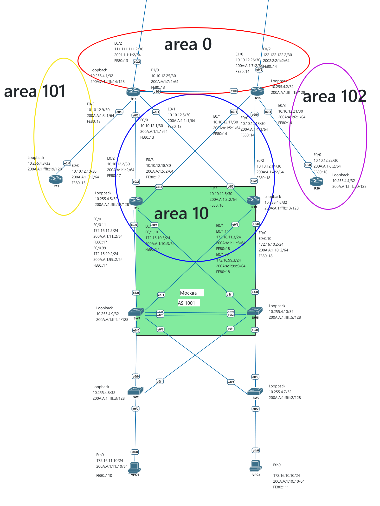

# OSPFv2. Фильтрация LSA

## Топология



## Цель
Настроить OSPF офисе Москва Разделить сеть на зоны Настроить фильтрацию между зонами.

## Задачи
- Часть 1. Маршрутизаторы R14-R15 находятся в зоне 0 - backbone
- Часть 2. Маршрутизаторы R12-R13 находятся в зоне 10. Дополнительно к маршрутам должны получать маршрут по умолчанию
- Часть 3. Маршрутизатор R19 находится в зоне 101 и получает только маршрут по умолчанию
- Часть 4. Маршрутизатор R20 находится в зоне 102 и получает все маршруты, кроме маршрутов до сетей зоны 101
- Часть 5. План работы и изменения зафиксированы в документации

---

## 1. Маршрутизаторы R14-R15 должны находиться в зоне 0 (backbone).

- R14
```
router ospf 1
 router-id 10.255.4.1
 passive-interface default
 area 10 stub
 area 101 stub no-summary
 no passive-interface Ethernet0/0
 no passive-interface Ethernet0/1
 no passive-interface Ethernet0/3
 no passive-interface Ethernet1/0
 exit
interface Ethernet0/0
 ip ospf 1 area 10
 exit
interface Ethernet0/1
 ip ospf 1 area 10
 exit
interface Ethernet0/3
 ip ospf 1 area 101
 exit
interface Ethernet1/0
 description OSPF BACKBONE TO R15
 ip address 10.10.12.25 255.255.255.252
 ipv6 address FE80::13 link-local
 ipv6 address 200A:A:1:7::1/64
 ip ospf network point-to-point
 ip ospf 1 area 0
 no shutdown
 exit
interface Loopback14
 ip ospf 1 area 0
 exit
```

**Таблица маршрутизации R14**
```
Gateway of last resort is not set

      10.0.0.0/8 is variably subnetted, 17 subnets, 2 masks
O        10.10.12.12/30 [110/20] via 10.10.12.6, 01:55:42, Ethernet0/1
O        10.10.12.16/30 [110/20] via 10.10.12.2, 01:55:42, Ethernet0/0
O IA     10.10.12.20/30 [110/20] via 10.10.12.26, 01:42:52, Ethernet1/0
O        10.255.4.2/32 [110/11] via 10.10.12.26, 01:55:42, Ethernet1/0
O        10.255.4.3/32 [110/11] via 10.10.12.10, 01:53:29, Ethernet0/3
O IA     10.255.4.4/32 [110/21] via 10.10.12.26, 01:40:04, Ethernet1/0
O        10.255.4.5/32 [110/11] via 10.10.12.2, 01:55:42, Ethernet0/0
O        10.255.4.6/32 [110/11] via 10.10.12.6, 01:55:42, Ethernet0/1
      172.16.0.0/24 is subnetted, 3 subnets
O        172.16.10.0 [110/20] via 10.10.12.6, 01:55:42, Ethernet0/1
```

- R15
```
ip prefix-list AREA102-IN seq 10 deny 10.10.12.8/30
ip prefix-list AREA102-IN seq 20 deny 10.255.4.3/32
ip prefix-list AREA102-IN seq 100 permit 0.0.0.0/0 le 32
router ospf 1
 router-id 10.255.4.2
 passive-interface default
 area 10 stub
 area 102 filter-list prefix AREA102-IN in
 no passive-interface Ethernet0/0
 no passive-interface Ethernet0/1
 no passive-interface Ethernet0/3
 no passive-interface Ethernet1/0
 exit
interface Ethernet0/0
 ip ospf 1 area 10
 exit
interface Ethernet0/1
 ip ospf 1 area 10
 exit
interface Ethernet0/3
 ip ospf 1 area 102
 exit
interface Ethernet1/0
 description OSPF BACKBONE TO R14
 ip address 10.10.12.26 255.255.255.252
 ipv6 address FE80::14 link-local
 ipv6 address 200A:A:1:7::2/64
 ip ospf network point-to-point
 ip ospf 1 area 0
 no shutdown
 exit
interface Loopback15
 ip ospf 1 area 0
 exit
```

**Таблица маршрутизации R15**
```
Gateway of last resort is not set

      10.0.0.0/8 is variably subnetted, 17 subnets, 2 masks
O        10.10.12.0/30 [110/20] via 10.10.12.18, 02:29:35, Ethernet0/1
O        10.10.12.4/30 [110/20] via 10.10.12.14, 02:25:47, Ethernet0/0
O IA     10.10.12.8/30 [110/20] via 10.10.12.25, 01:56:05, Ethernet1/0
O        10.255.4.1/32 [110/11] via 10.10.12.25, 02:32:25, Ethernet1/0
O IA     10.255.4.3/32 [110/21] via 10.10.12.25, 01:54:27, Ethernet1/0
O        10.255.4.4/32 [110/11] via 10.10.12.22, 01:41:03, Ethernet0/3
O        10.255.4.5/32 [110/11] via 10.10.12.18, 02:28:18, Ethernet0/1
O        10.255.4.6/32 [110/11] via 10.10.12.14, 02:24:28, Ethernet0/0
      172.16.0.0/24 is subnetted, 3 subnets
O        172.16.10.0 [110/20] via 10.10.12.18, 02:28:33, Ethernet0/1
                     [110/20] via 10.10.12.14, 02:25:42, Ethernet0/0
O        172.16.11.0 [110/20] via 10.10.12.18, 02:29:20, Ethernet0/1
                     [110/20] via 10.10.12.14, 02:25:10, Ethernet0/0
O        172.16.99.0 [110/20] via 10.10.12.18, 02:28:59, Ethernet0/1
                     [110/20] via 10.10.12.14, 02:24:44, Ethernet0/0
```

---

## 2. Маршрутизаторы R12-R13 должны находиться в зоне 10. Дополнительно к маршрутам должны получать маршрут по умолчанию.

- R12
```
router ospf 1
 router-id 10.255.4.5
 passive-interface default
 area 10 stub
 no passive-interface Ethernet0/2
 no passive-interface Ethernet0/3
 exit
interface Ethernet0/2
 ip ospf 1 area 10
 exit
interface Ethernet0/3
 ip ospf 1 area 10
 exit
interface Ethernet0/0.11
 ip ospf 1 area 10
 exit
interface Ethernet0/0.99
 ip ospf 1 area 10
 exit
interface Ethernet0/1.10
 ip ospf 1 area 10
 exit
interface Loopback12
 ip ospf 1 area 10
 exit
```

**Таблица маршрутизации R12**
```
Gateway of last resort is 10.10.12.17 to network 0.0.0.0

O*IA  0.0.0.0/0 [110/11] via 10.10.12.17, 02:30:03, Ethernet0/3
                [110/11] via 10.10.12.1, 02:30:28, Ethernet0/2
      10.0.0.0/8 is variably subnetted, 15 subnets, 2 masks
O        10.10.12.4/30 [110/20] via 10.10.12.1, 02:30:28, Ethernet0/2
O IA     10.10.12.8/30 [110/20] via 10.10.12.1, 01:56:38, Ethernet0/2
O        10.10.12.12/30 [110/20] via 10.10.12.17, 02:30:03, Ethernet0/3
O IA     10.10.12.20/30 [110/20] via 10.10.12.17, 01:44:23, Ethernet0/3
O IA     10.10.12.24/30 [110/20] via 10.10.12.17, 02:30:03, Ethernet0/3
                        [110/20] via 10.10.12.1, 02:30:28, Ethernet0/2
O IA     10.255.4.1/32 [110/11] via 10.10.12.1, 02:30:28, Ethernet0/2
O IA     10.255.4.2/32 [110/11] via 10.10.12.17, 02:30:03, Ethernet0/3
O IA     10.255.4.3/32 [110/21] via 10.10.12.1, 01:54:59, Ethernet0/2
O IA     10.255.4.4/32 [110/21] via 10.10.12.17, 01:41:35, Ethernet0/3
O        10.255.4.6/32 [110/21] via 10.10.12.17, 02:25:00, Ethernet0/3
                       [110/21] via 10.10.12.1, 02:25:00, Ethernet0/2
```

- R13
```
router ospf 1
 router-id 10.255.4.6
 passive-interface default
 area 10 stub
 no passive-interface Ethernet0/2
 no passive-interface Ethernet0/3
 exit
interface Ethernet0/2
 ip ospf 1 area 10
 exit
interface Ethernet0/3
 ip ospf 1 area 10
 exit
interface Ethernet0/0.10
 ip ospf 1 area 10
 exit
interface Ethernet0/1.11
 ip ospf 1 area 10
 exit
interface Ethernet0/1.99
 ip ospf 1 area 10
 exit
interface Loopback13
 ip ospf 1 area 10
 exit
```

**Таблица маршрутизации R13**
```
Gateway of last resort is 10.10.12.13 to network 0.0.0.0

O*IA  0.0.0.0/0 [110/11] via 10.10.12.13, 02:27:34, Ethernet0/2
                [110/11] via 10.10.12.5, 02:27:19, Ethernet0/3
      10.0.0.0/8 is variably subnetted, 15 subnets, 2 masks
O        10.10.12.0/30 [110/20] via 10.10.12.5, 02:27:19, Ethernet0/3
O IA     10.10.12.8/30 [110/20] via 10.10.12.5, 01:57:28, Ethernet0/3
O        10.10.12.16/30 [110/20] via 10.10.12.13, 02:27:34, Ethernet0/2
O IA     10.10.12.20/30 [110/20] via 10.10.12.13, 01:45:13, Ethernet0/2
O IA     10.10.12.24/30 [110/20] via 10.10.12.13, 02:27:34, Ethernet0/2
                        [110/20] via 10.10.12.5, 02:27:19, Ethernet0/3
O IA     10.255.4.1/32 [110/11] via 10.10.12.5, 02:27:19, Ethernet0/3
O IA     10.255.4.2/32 [110/11] via 10.10.12.13, 02:27:34, Ethernet0/2
O IA     10.255.4.3/32 [110/21] via 10.10.12.5, 01:55:50, Ethernet0/3
O IA     10.255.4.4/32 [110/21] via 10.10.12.13, 01:42:26, Ethernet0/2
O        10.255.4.5/32 [110/21] via 10.10.12.13, 02:27:34, Ethernet0/2
                       [110/21] via 10.10.12.5, 02:27:19, Ethernet0/3
```

## 3. Маршрутизатор R19 должен находиться в зоне 101 и получать только маршрут по умолчанию.

Включим OSPF на маршрутизаторе R19. Добавим его в зону 101. Отфильтруем маршруты для R19 посредством настройки _prefix-list_ на R14. Применим фильтр на вход в зону 101.

- R19
```
router ospf 1
 router-id 10.255.4.3
 passive-interface default
 area 101 stub
 no passive-interface Ethernet0/0
 exit
interface Ethernet0/0
 ip ospf 1 area 101
 exit
interface Loopback19
 ip ospf 1 area 101
 exit
```

**Таблица маршрутизации R19**
```
R19#sh ip route ospf
Codes: L - local, C - connected, S - static, R - RIP, M - mobile, B - BGP
       D - EIGRP, EX - EIGRP external, O - OSPF, IA - OSPF inter area 
       N1 - OSPF NSSA external type 1, N2 - OSPF NSSA external type 2
       E1 - OSPF external type 1, E2 - OSPF external type 2
       i - IS-IS, su - IS-IS summary, L1 - IS-IS level-1, L2 - IS-IS level-2
       ia - IS-IS inter area, * - candidate default, U - per-user static route
       o - ODR, P - periodic downloaded static route, H - NHRP, l - LISP
       + - replicated route, % - next hop override

Gateway of last resort is 10.10.12.9 to network 0.0.0.0

O*IA  0.0.0.0/0 [110/11] via 10.10.12.9, 02:32:17, Ethernet0/0
```

## 4. Маршрутизатор R20 должен находиться в зоне 102 и получать все маршруты, кроме маршрутов до сетей зоны 101.

Настройка фильтрации сводится к настройке _prefix-list_ на пограничном роутере R15. Запретим передачу префикса зоны 101 в зону 102 и разрешим остальные.

- R20
```
router ospf 1
 router-id 10.255.4.4
 passive-interface default
 no passive-interface Ethernet0/0
 exit
interface Ethernet0/0
 ip ospf 1 area 102
 exit
interface Loopback20
 ip ospf 1 area 102
 exit
```

**Таблица маршрутизации R20**
```
Gateway of last resort is not set

      10.0.0.0/8 is variably subnetted, 12 subnets, 2 masks
O IA     10.10.12.0/30 [110/30] via 10.10.12.21, 02:19:27, Ethernet0/0
O IA     10.10.12.4/30 [110/30] via 10.10.12.21, 02:19:27, Ethernet0/0
O IA     10.10.12.12/30 [110/20] via 10.10.12.21, 02:19:27, Ethernet0/0
O IA     10.10.12.16/30 [110/20] via 10.10.12.21, 02:19:27, Ethernet0/0
O IA     10.10.12.24/30 [110/20] via 10.10.12.21, 02:19:27, Ethernet0/0
O IA     10.255.4.1/32 [110/21] via 10.10.12.21, 02:19:27, Ethernet0/0
O IA     10.255.4.2/32 [110/11] via 10.10.12.21, 02:19:27, Ethernet0/0
O IA     10.255.4.5/32 [110/21] via 10.10.12.21, 02:19:27, Ethernet0/0
O IA     10.255.4.6/32 [110/21] via 10.10.12.21, 02:19:27, Ethernet0/0
      172.16.0.0/24 is subnetted, 3 subnets
O IA     172.16.10.0 [110/30] via 10.10.12.21, 02:19:27, Ethernet0/0
O IA     172.16.11.0 [110/30] via 10.10.12.21, 02:19:27, Ethernet0/0
O IA     172.16.99.0 [110/30] via 10.10.12.21, 02:19:27, Ethernet0/0
```
---

| Зона                              | Устройства и сети                                   | Что получили                                                    |
| --------------------------------- | --------------------------------------------------- | --------------------------------------------------------------- |
| **0 — backbone**                  | Прямой стык R14–R15 и их Loopback                   | R14 и R15 обмениваются маршрутами между зонами через ядро.      |
| **10 — stub**                     | R12 и R13, четыре стыка к R14/R15, VLAN 10, 11 и 99 | R12 и R13 получают межзонные маршруты и маршрут по умолчанию.   |
| **101 — totally stub**            | Стык R14–R19 и Loopback R19                         | R19 получает по OSPF только маршрут по умолчанию.               |
| **102 — обычная зона с фильтром** | Стык R15–R20 и Loopback R20                         | R20 получает межзонные маршруты, кроме двух префиксов зоны 101. |

**Конфигурации:**

- [R12](Configurations/R12.txt)
- [R13](Configurations/R13.txt)
- [R14](Configurations/R14.txt)
- [R15](Configurations/R15.txt)
- [R19](Configurations/R19.txt)
- [R20](Configurations/R20.txt)