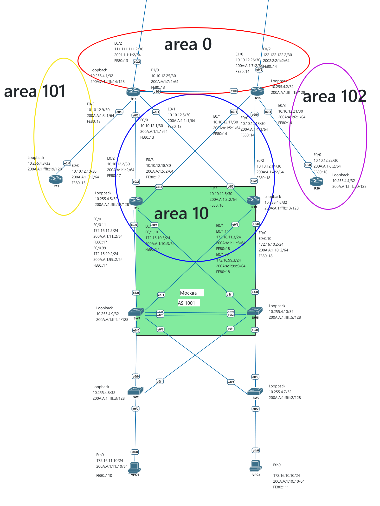

# OSPFv3 для IPv6. Фильтрация LSA

## Топология



## Цель
Настроить OSPF для IPv6, сохранив ту же логику работы, что у OSPF для IPv4

## Задачи
- Часть 1. Настроите OSPF для IPv6. сохранив ту же логику работы(метрики, таймеры, фильтры - по возможности), что OSPF для IPv4
- Часть 2.  План работы и изменения зафиксированы в документации.

---

## 1. Маршрутизаторы R14-R15 должны находиться в зоне 0 (backbone).

- R14
```
ipv6 router ospf 1
 router-id 10.255.4.1
 area 10 stub
 area 101 stub no-summary
 passive-interface default
 no passive-interface Ethernet1/0
 no passive-interface Ethernet0/0
 no passive-interface Ethernet0/1
 no passive-interface Ethernet0/3
exit
interface Ethernet1/0
 ipv6 ospf network point-to-point
 ipv6 ospf 1 area 0
exit
interface Loopback14
 ipv6 ospf 1 area 0
exit
interface Ethernet0/0
  ipv6 ospf 1 area 10
exit
interface Ethernet0/1
  ipv6 ospf 1 area 10
exit
interface Ethernet0/3
  ipv6 ospf 1 area 101
exit
```

**Таблица маршрутизации R14**
```
R14#show ipv6 route ospf 
IPv6 Routing Table - default - 23 entries
Codes: C - Connected, L - Local, S - Static, U - Per-user Static route
       B - BGP, HA - Home Agent, MR - Mobile Router, R - RIP
       H - NHRP, I1 - ISIS L1, I2 - ISIS L2, IA - ISIS interarea
       IS - ISIS summary, D - EIGRP, EX - EIGRP external, NM - NEMO
       ND - ND Default, NDp - ND Prefix, DCE - Destination, NDr - Redirect
       O - OSPF Intra, OI - OSPF Inter, OE1 - OSPF ext 1, OE2 - OSPF ext 2
       ON1 - OSPF NSSA ext 1, ON2 - OSPF NSSA ext 2, l - LISP
O   200A:A:1:4::/64 [110/20]
     via FE80::18, Ethernet0/1
O   200A:A:1:5::/64 [110/20]
     via FE80::17, Ethernet0/0
OI  200A:A:1:6::/64 [110/20]
     via FE80::14, Ethernet1/0
O   200A:A:1:10::/64 [110/20]
     via FE80::17, Ethernet0/0
     via FE80::18, Ethernet0/1
O   200A:A:1:11::/64 [110/20]
     via FE80::17, Ethernet0/0
     via FE80::18, Ethernet0/1
O   200A:A:1:99::/64 [110/20]
     via FE80::17, Ethernet0/0
     via FE80::18, Ethernet0/1
O   200A:A:1:FFFF::12/128 [110/10]
     via FE80::17, Ethernet0/0
O   200A:A:1:FFFF::13/128 [110/10]
     via FE80::18, Ethernet0/1
O   200A:A:1:FFFF::15/128 [110/10]
     via FE80::14, Ethernet1/0
O   200A:A:1:FFFF::19/128 [110/10]
     via FE80::15, Ethernet0/3
OI  200A:A:1:FFFF::20/128 [110/20]
     via FE80::14, Ethernet1/0
```

- R15
```
ipv6 router ospf 1
 router-id 10.255.4.2
 area 10 stub
 passive-interface default
 no passive-interface Ethernet1/0
 no passive-interface Ethernet0/0
 no passive-interface Ethernet0/1
 no passive-interface Ethernet0/3
exit
interface Ethernet1/0
 ipv6 ospf network point-to-point
 ipv6 ospf 1 area 0
exit
interface Loopback15
 ipv6 ospf 1 area 0
exit

interface Ethernet0/0
  ipv6 ospf 1 area 10
exit
interface Ethernet0/1
  ipv6 ospf 1 area 10
exit
interface Ethernet0/3
  ipv6 ospf 1 area 102
exit
```

**Таблица маршрутизации R15**
```
R15#sh ipv6 route ospf 
IPv6 Routing Table - default - 23 entries
Codes: C - Connected, L - Local, S - Static, U - Per-user Static route
       B - BGP, HA - Home Agent, MR - Mobile Router, R - RIP
       H - NHRP, I1 - ISIS L1, I2 - ISIS L2, IA - ISIS interarea
       IS - ISIS summary, D - EIGRP, EX - EIGRP external, NM - NEMO
       ND - ND Default, NDp - ND Prefix, DCE - Destination, NDr - Redirect
       O - OSPF Intra, OI - OSPF Inter, OE1 - OSPF ext 1, OE2 - OSPF ext 2
       ON1 - OSPF NSSA ext 1, ON2 - OSPF NSSA ext 2, l - LISP
O   200A:A:1:1::/64 [110/20]
     via FE80::17, Ethernet0/1
O   200A:A:1:2::/64 [110/20]
     via FE80::18, Ethernet0/0
OI  200A:A:1:3::/64 [110/20]
     via FE80::13, Ethernet1/0
O   200A:A:1:10::/64 [110/20]
     via FE80::18, Ethernet0/0
     via FE80::17, Ethernet0/1
O   200A:A:1:11::/64 [110/20]
     via FE80::18, Ethernet0/0
     via FE80::17, Ethernet0/1
O   200A:A:1:99::/64 [110/20]
     via FE80::18, Ethernet0/0
     via FE80::17, Ethernet0/1
O   200A:A:1:FFFF::12/128 [110/10]
     via FE80::17, Ethernet0/1
O   200A:A:1:FFFF::13/128 [110/10]
     via FE80::18, Ethernet0/0
O   200A:A:1:FFFF::14/128 [110/10]
     via FE80::13, Ethernet1/0
OI  200A:A:1:FFFF::19/128 [110/20]
     via FE80::13, Ethernet1/0
O   200A:A:1:FFFF::20/128 [110/10]
     via FE80::16, Ethernet0/3
```

---

## 2. Маршрутизаторы R12-R13 должны находиться в зоне 10. Дополнительно к маршрутам должны получать маршрут по умолчанию.

- R12
```
ipv6 unicast-routing
ipv6 router ospf 1
  router-id 10.255.4.5
  area 10 stub
  passive-interface default
  no passive-interface Ethernet0/2
  no passive-interface Ethernet0/3
exit
interface Ethernet0/2
  ipv6 ospf 1 area 10
exit
interface Ethernet0/3
  ipv6 ospf 1 area 10
exit
interface Ethernet0/0.11
  ipv6 ospf 1 area 10
exit
interface Ethernet0/0.99
  ipv6 ospf 1 area 10
exit
interface Ethernet0/1.10
  ipv6 ospf 1 area 10
exit
interface Loopback12
  ipv6 ospf 1 area 10
exit
```

**Таблица маршрутизации R12**
```
R12#sh ipv6 route ospf 
IPv6 Routing Table - default - 23 entries
Codes: C - Connected, L - Local, S - Static, U - Per-user Static route
       B - BGP, HA - Home Agent, MR - Mobile Router, R - RIP
       H - NHRP, I1 - ISIS L1, I2 - ISIS L2, IA - ISIS interarea
       IS - ISIS summary, D - EIGRP, EX - EIGRP external, NM - NEMO
       ND - ND Default, NDp - ND Prefix, DCE - Destination, NDr - Redirect
       O - OSPF Intra, OI - OSPF Inter, OE1 - OSPF ext 1, OE2 - OSPF ext 2
       ON1 - OSPF NSSA ext 1, ON2 - OSPF NSSA ext 2, l - LISP
OI  ::/0 [110/11]
     via FE80::13, Ethernet0/2
     via FE80::14, Ethernet0/3
O   200A:A:1:2::/64 [110/20]
     via FE80::13, Ethernet0/2
OI  200A:A:1:3::/64 [110/20]
     via FE80::13, Ethernet0/2
O   200A:A:1:4::/64 [110/20]
     via FE80::14, Ethernet0/3
OI  200A:A:1:6::/64 [110/20]
     via FE80::14, Ethernet0/3
OI  200A:A:1:7::/64 [110/20]
     via FE80::13, Ethernet0/2
     via FE80::14, Ethernet0/3
O   200A:A:1:FFFF::13/128 [110/20]
     via FE80::13, Ethernet0/2
     via FE80::14, Ethernet0/3
OI  200A:A:1:FFFF::14/128 [110/10]
     via FE80::13, Ethernet0/2
OI  200A:A:1:FFFF::15/128 [110/10]
     via FE80::14, Ethernet0/3
OI  200A:A:1:FFFF::19/128 [110/20]
     via FE80::13, Ethernet0/2
OI  200A:A:1:FFFF::20/128 [110/20]
     via FE80::14, Ethernet0/3
```

- R13
```
ipv6 unicast-routing
ipv6 router ospf 1
  router-id 10.255.4.6
  area 10 stub
  passive-interface default
  no passive-interface Ethernet0/2
  no passive-interface Ethernet0/3
exit
interface Ethernet0/2
  ipv6 ospf 1 area 10
exit
interface Ethernet0/3
  ipv6 ospf 1 area 10
exit
interface Ethernet0/0.10
  ipv6 ospf 1 area 10
exit
interface Ethernet0/1.11
  ipv6 ospf 1 area 10
exit
interface Ethernet0/1.99
  ipv6 ospf 1 area 10
exit
interface Loopback13
  ipv6 ospf 1 area 10
exit
```

**Таблица маршрутизации R13**
```
R13#sh ipv6 route ospf 
IPv6 Routing Table - default - 23 entries
Codes: C - Connected, L - Local, S - Static, U - Per-user Static route
       B - BGP, HA - Home Agent, MR - Mobile Router, R - RIP
       H - NHRP, I1 - ISIS L1, I2 - ISIS L2, IA - ISIS interarea
       IS - ISIS summary, D - EIGRP, EX - EIGRP external, NM - NEMO
       ND - ND Default, NDp - ND Prefix, DCE - Destination, NDr - Redirect
       O - OSPF Intra, OI - OSPF Inter, OE1 - OSPF ext 1, OE2 - OSPF ext 2
       ON1 - OSPF NSSA ext 1, ON2 - OSPF NSSA ext 2, l - LISP
OI  ::/0 [110/11]
     via FE80::13, Ethernet0/3
     via FE80::14, Ethernet0/2
O   200A:A:1:1::/64 [110/20]
     via FE80::13, Ethernet0/3
OI  200A:A:1:3::/64 [110/20]
     via FE80::13, Ethernet0/3
O   200A:A:1:5::/64 [110/20]
     via FE80::14, Ethernet0/2
OI  200A:A:1:6::/64 [110/20]
     via FE80::14, Ethernet0/2
OI  200A:A:1:7::/64 [110/20]
     via FE80::13, Ethernet0/3
     via FE80::14, Ethernet0/2
O   200A:A:1:FFFF::12/128 [110/20]
     via FE80::13, Ethernet0/3
     via FE80::14, Ethernet0/2
OI  200A:A:1:FFFF::14/128 [110/10]
     via FE80::13, Ethernet0/3
OI  200A:A:1:FFFF::15/128 [110/10]
     via FE80::14, Ethernet0/2
OI  200A:A:1:FFFF::19/128 [110/20]
     via FE80::13, Ethernet0/3
OI  200A:A:1:FFFF::20/128 [110/20]
     via FE80::14, Ethernet0/2
```

## 3. Маршрутизатор R19 должен находиться в зоне 101 и получать только маршрут по умолчанию.

- R19
```
ipv6 unicast-routing
ipv6 router ospf 1
  router-id 10.255.4.3
  area 101 stub
  passive-interface default
  no passive-interface Ethernet0/0
exit
interface Ethernet0/0
  ipv6 ospf 1 area 101
exit
interface Loopback19
  ipv6 ospf 1 area 101
exit
```

**Таблица маршрутизации R19**
```
R19#show ipv6 route ospf 
IPv6 Routing Table - default - 5 entries
Codes: C - Connected, L - Local, S - Static, U - Per-user Static route
       B - BGP, HA - Home Agent, MR - Mobile Router, R - RIP
       H - NHRP, I1 - ISIS L1, I2 - ISIS L2, IA - ISIS interarea
       IS - ISIS summary, D - EIGRP, EX - EIGRP external, NM - NEMO
       ND - ND Default, NDp - ND Prefix, DCE - Destination, NDr - Redirect
       O - OSPF Intra, OI - OSPF Inter, OE1 - OSPF ext 1, OE2 - OSPF ext 2
       ON1 - OSPF NSSA ext 1, ON2 - OSPF NSSA ext 2, l - LISP
OI  ::/0 [110/11]
     via FE80::13, Ethernet0/0
```

## 4. Маршрутизатор R20 должен находиться в зоне 102 и получать все маршруты, кроме маршрутов до сетей зоны 101.

Настройка фильтрации сводится к настройке _prefix-list_ на пограничном роутере R15. Запретим передачу префикса зоны 101 в зону 102 и разрешим остальные.

Cisco IOS не поддерживает `area filter-list prefix`.
Вместо этого я использовал **IPv6 prefix-list и** `distribute-list` **на R20** для фильтрации маршрутов.

- R20
```
ipv6 prefix-list AREA102-IN-V6 seq 10 deny 200A:A:1:3::/64
ipv6 prefix-list AREA102-IN-V6 seq 20 deny 200A:A:1:FFFF::19/128
ipv6 prefix-list AREA102-IN-V6 seq 100 permit ::/0 le 128

ipv6 unicast-routing
ipv6 router ospf 1
  router-id 10.255.4.4
  passive-interface default
  no passive-interface Ethernet0/0
  distribute-list prefix-list AREA102-IN-V6 in Ethernet0/0
exit
interface Ethernet0/0
  ipv6 ospf 1 area 102
exit
interface Loopback20
  ipv6 ospf 1 area 102
exit
```

**Таблица маршрутизации R20**
```
IPv6 Routing Table - default - 16 entries
Codes: C - Connected, L - Local, S - Static, U - Per-user Static route
       B - BGP, HA - Home Agent, MR - Mobile Router, R - RIP
       H - NHRP, I1 - ISIS L1, I2 - ISIS L2, IA - ISIS interarea
       IS - ISIS summary, D - EIGRP, EX - EIGRP external, NM - NEMO
       ND - ND Default, NDp - ND Prefix, DCE - Destination, NDr - Redirect
       O - OSPF Intra, OI - OSPF Inter, OE1 - OSPF ext 1, OE2 - OSPF ext 2
       ON1 - OSPF NSSA ext 1, ON2 - OSPF NSSA ext 2, l - LISP
OI  200A:A:1:1::/64 [110/30]
     via FE80::14, Ethernet0/0
OI  200A:A:1:2::/64 [110/30]
     via FE80::14, Ethernet0/0
OI  200A:A:1:4::/64 [110/20]
     via FE80::14, Ethernet0/0
OI  200A:A:1:5::/64 [110/20]
     via FE80::14, Ethernet0/0
OI  200A:A:1:7::/64 [110/20]
     via FE80::14, Ethernet0/0
OI  200A:A:1:10::/64 [110/30]
     via FE80::14, Ethernet0/0
OI  200A:A:1:11::/64 [110/30]
     via FE80::14, Ethernet0/0
OI  200A:A:1:99::/64 [110/30]
     via FE80::14, Ethernet0/0
OI  200A:A:1:FFFF::12/128 [110/20]
     via FE80::14, Ethernet0/0
OI  200A:A:1:FFFF::13/128 [110/20]
     via FE80::14, Ethernet0/0
OI  200A:A:1:FFFF::14/128 [110/20]
     via FE80::14, Ethernet0/0
OI  200A:A:1:FFFF::15/128 [110/10]
     via FE80::14, Ethernet0/0
```

До настройки `distribute-list` R20 получал **14 межзонных IPv6-маршрутов**. После настройки осталось **12**.

**Таблица маршрутизации R20**
```
R20#sh ipv6 route ospf 
IPv6 Routing Table - default - 16 entries
Codes: C - Connected, L - Local, S - Static, U - Per-user Static route
       B - BGP, HA - Home Agent, MR - Mobile Router, R - RIP
       H - NHRP, I1 - ISIS L1, I2 - ISIS L2, IA - ISIS interarea
       IS - ISIS summary, D - EIGRP, EX - EIGRP external, NM - NEMO
       ND - ND Default, NDp - ND Prefix, DCE - Destination, NDr - Redirect
       O - OSPF Intra, OI - OSPF Inter, OE1 - OSPF ext 1, OE2 - OSPF ext 2
       ON1 - OSPF NSSA ext 1, ON2 - OSPF NSSA ext 2, l - LISP
OI  200A:A:1:1::/64 [110/30]
     via FE80::14, Ethernet0/0
OI  200A:A:1:2::/64 [110/30]
     via FE80::14, Ethernet0/0
OI  200A:A:1:4::/64 [110/20]
     via FE80::14, Ethernet0/0
OI  200A:A:1:5::/64 [110/20]
     via FE80::14, Ethernet0/0
OI  200A:A:1:7::/64 [110/20]
     via FE80::14, Ethernet0/0
OI  200A:A:1:10::/64 [110/30]
     via FE80::14, Ethernet0/0
OI  200A:A:1:11::/64 [110/30]
     via FE80::14, Ethernet0/0
OI  200A:A:1:99::/64 [110/30]
     via FE80::14, Ethernet0/0
OI  200A:A:1:FFFF::12/128 [110/20]
     via FE80::14, Ethernet0/0
OI  200A:A:1:FFFF::13/128 [110/20]
     via FE80::14, Ethernet0/0
OI  200A:A:1:FFFF::14/128 [110/20]
     via FE80::14, Ethernet0/0
OI  200A:A:1:FFFF::15/128 [110/10]
     via FE80::14, Ethernet0/0
```

---

| Зона                              | Устройства и сети                                   | Что получили                                                    |
| --------------------------------- | --------------------------------------------------- | --------------------------------------------------------------- |
| **0 — backbone**                  | Прямой стык R14–R15 и их Loopback                   | R14 и R15 обмениваются маршрутами между зонами через ядро.      |
| **10 — stub**                     | R12 и R13, четыре стыка к R14/R15, VLAN 10, 11 и 99 | R12 и R13 получают межзонные маршруты и маршрут по умолчанию.   |
| **101 — totally stub**            | Стык R14–R19 и Loopback R19                         | R19 получает по OSPF только маршрут по умолчанию.               |
| **102 — обычная зона с фильтром** | Стык R15–R20 и Loopback R20                         | R20 получает межзонные маршруты, кроме двух префиксов зоны 101. |

**Конфигурации:**

- [R12](Configurations/R12.txt)
- [R13](Configurations/R13.txt)
- [R14](Configurations/R14.txt)
- [R15](Configurations/R15.txt)
- [R19](Configurations/R19.txt)
- [R20](Configurations/R20.txt)